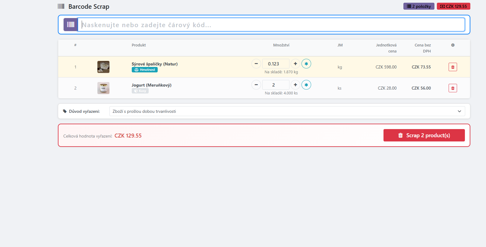
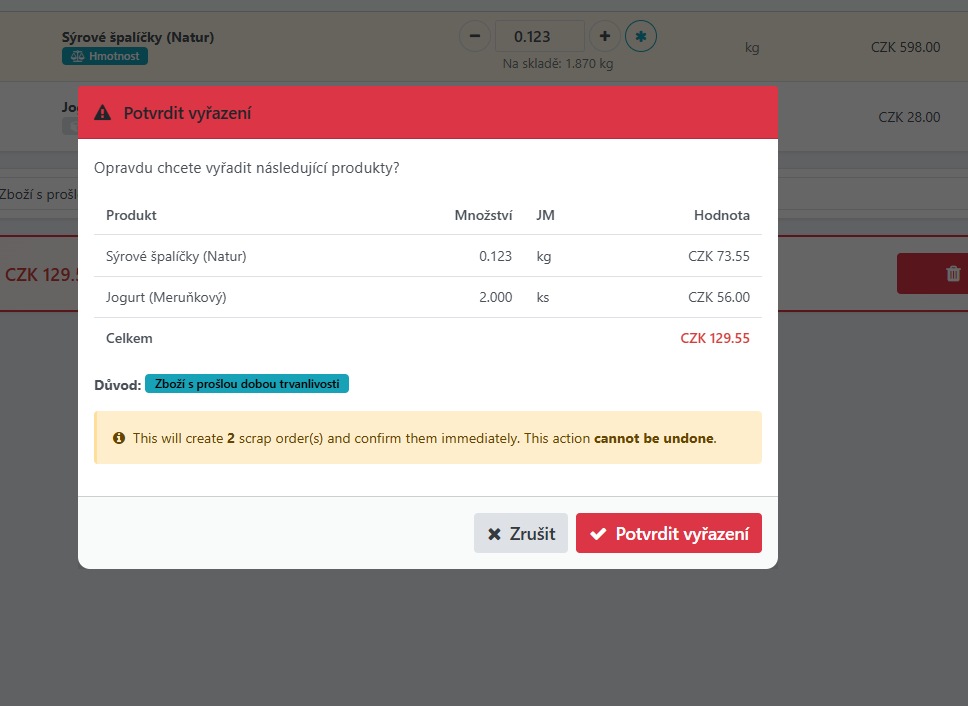
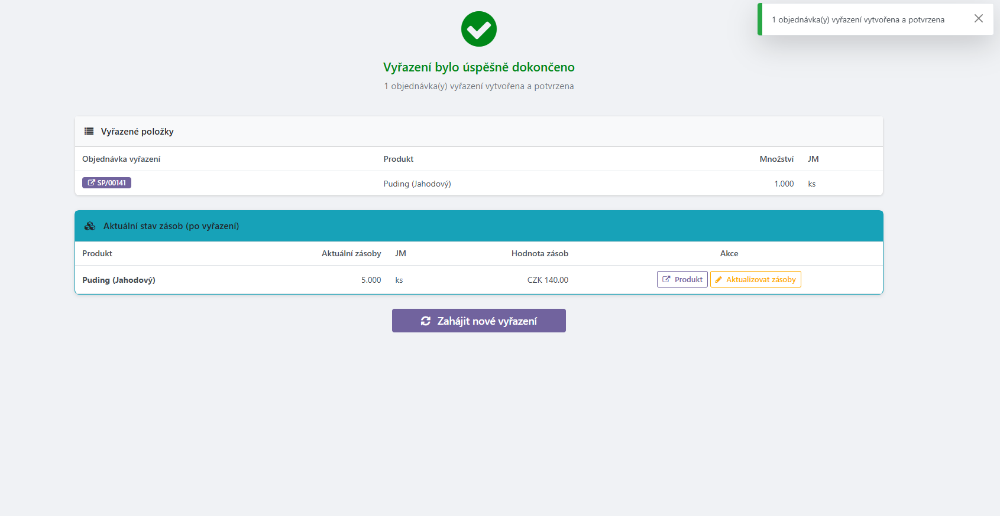

# MRP Barcode Scrap

Odoo 20 Community Edition addon for batch scrapping products via barcode scanning, counting the
stock with the same scanner, and quick stock updates from the product form.

## Features

- **POS-like barcode scanning interface** — fast, keyboard-driven workflow
- **Weight-embedded barcode support** — automatic detection via Odoo barcode nomenclature
- **Piece-count barcode support** — standard product barcodes increment by 1
- **Running totals** — see quantity and value per scanned product in real-time
- **Editable quantities** — adjust amounts with +/- buttons or direct input
- **Configurable default scrap reason** — set once, use every time
- **Total scrap value** — always visible summary
- **Batch scrapping** — one click scraps every product right away: one done scrap per product, listed in
  *Inventory › Operations › Adjustments › Scrap* (reference `SP/xxxxx`, scrap reason tags)
- **Confirmation popup** — review everything before committing
- **Post-scrap stock review** — see updated stock values with links to adjust inventory
- **Inventory count mode** — switch in the top right corner of the dashboard; scanned quantities add up
  and become the new stock of the scanned products
- **Update Stock / Set Stock to Zero** — buttons on the product and variant form, plus a list action
  that sets the stock of the selected products to zero
- **Czech translation included**

## Screenshots







## Installation

1. Copy the `mrp_barcode_scrap` folder to your Odoo addons directory.
2. Update the apps list in Odoo (Settings → Apps → Update Apps List).
3. Search for "MRP Barcode Scrap" and install.

## Configuration

1. Go to **Manufacturing → Configuration → Scrap Configuration**.
2. Set the default scrap reason (e.g., "Expired product").

## Usage

### Scrapping

1. Navigate to **Manufacturing → Barcode Scrap**.
2. Scan product barcodes (or type them manually).
3. Adjust quantities as needed.
4. Edit the scrap reason if necessary.
5. Click **Scrap** and confirm in the popup.
6. Review the post-scrap stock levels and adjust if needed. *Open Scraps* (or a reference) opens
   the scraps in the standard Scrap views.

Quantities are capped at the stock of the warehouse stock location (sub-locations included); products
without stock are skipped and listed on the result screen.
Products tracked by lots or serial numbers are scrapped from the lots Odoo reserves by the removal
strategy (FIFO, FEFO with expiry dates); there is no lot picker on the dashboard.

### Inventory count

1. On the dashboard turn on the **Inventory** switch in the top right corner (only inventory
   administrators see it). The screen turns blue and the title changes to *Inventory Count*.
2. Scan every piece that is really in stock. Scans of the same product add up (pieces +1, weight
   barcodes add their weight); the quantity can also be typed or changed with +/-. A quantity of 0
   is a valid count: the stock of that product goes to zero.
3. The list shows the current stock and the difference. **Apply Inventory Count** shows a summary
   and after confirmation sets the stock of the scanned products to the counted quantity.
   **Products that were not scanned are not changed.**
4. The result screen shows the stock before and after, with links to the product and to *Update Stock*.

An unfinished count is kept in the browser (per user) and restored after a page reload or when you
come back from another menu. Switching the mode with scanned products asks first and clears the list.
Products that do not track stock are refused on scan; products tracked by lots or serial numbers
must be counted in *Inventory › Physical Inventory*.

### Update Stock / Set Stock to Zero

- **Product or variant form** (header, inventory administrators only):
  - *Update Stock* opens a dialog with the current and the new quantity, one line per variant
    (a product template with variants lists all of them). Only changed lines are booked.
  - *Set Stock to Zero* asks for confirmation and sets the stock of the product (all its variants on
    a template, only that variant on a variant form) to 0.
- **Product or variant list**: select products → *Actions* → *Set Stock to Zero*. A dialog lists the
  selected products that have stock (already zero ones are left out), lines can be removed, and the
  button *Set Stock to Zero* applies it.

Every change is a regular inventory adjustment (move from/to the inventory loss location) in the
main warehouse of the company, with the reference *Inventory count (barcode)*, *Stock updated
manually* or *Stock set to zero* in the moves history. The whole stock of the product in the
warehouse (all its internal locations) is set to the new quantity. Negative stock is fine as a
starting point; a negative target is refused.

## Dependencies

- `mrp` (Manufacturing)
- `stock` (Inventory)
- `barcodes` (Barcode Nomenclature)
- `product` (Products)

## Tests

```
odoo -d <db> -i mrp_barcode_scrap --test-enable --test-tags /mrp_barcode_scrap --stop-after-init
```

29 tests: `test_quick_inventory` (inventory count, Update Stock / Set Stock to Zero) and
`test_scrap_dashboard` (scrapping from the dashboard).

## Odoo 20

Port z 19.0.1.1.0 na **20.0.1.1.0** (větev `20.0`). Chování pro obsluhu zůstává stejné, změnilo se
hlavně to, co je pod ním.

**Co se změnilo v kódu**

- **Vyřazení bez `stock.scrap`.** Odoo 20 model `stock.scrap` zrušilo, vyřazení je `stock.move`
  s `is_scrap` a štítky `scrap_reason_tag_ids`. Dashboard proto zakládá pro každý produkt jeden pohyb
  vyřazení ze skladového místa hlavního skladu do místa vyřazení firmy (`company.scrap_location_id`)
  a hned ho dokončí (`_action_scrap()`, reference z řady `stock.scrap`, tedy dál `SP/xxxxx`).
  Metoda `create_scrap_orders` se jmenuje `create_scrap_moves`, odkazy na výsledné obrazovce otevírají
  standardní formulář / seznam vyřazení (`stock.view_scrap_move_form` / `_list`). Množství se omezuje
  stavem skladového místa včetně podřízených míst; pohyb si rezervuje kvanta i z podřízených míst
  (v 19 bral jen přímo `WH/Stock`). Výsledná obrazovka nově ukazuje přeskočené produkty (bez skladu)
  a značku „omezeno“, když se vyřadilo méně, než bylo naskenováno.
  Produkt sledovaný po šaržích / sériových číslech: Odoo 20 si šarži rezervuje samo podle strategie
  vyskladnění (v 19 se vyřazení zaúčtovalo bez šarže a kvant bez šarže šel do minusu). Na produkci
  takové produkty zatím nejsou.
- **Práva:** `security/ir.model.access.csv` → `security/ir.access.csv` (nový model `ir.access`,
  sloupce `operation`/`domain`), stejných šest pravidel pod stejnými XML ID.
- **OWL 3:** komponenta bez `static props` (Owl 3 by vyhodil chybu), `props = useProps(...)`,
  `proxy` místo `useState`, ref přes `signal.ref()`, v šabloně `this.` u všeho z komponenty,
  `t-out` místo `t-esc`, akce / notifikace / dialogy přes pluginy (`ActionPlugin`, `NotificationPlugin`,
  `DialogPlugin`). Pozor: náhled `upgrade_code --script owl3-migration` importoval `useRef` z
  `@web/owl2/utils` a `ActionManagerPlugin`, obojí ve 20.0 neexistuje, port je proto psaný ručně.
- **Ikony:** Odoo 20 už nenačítá Font Awesome; ikony jsou Material Symbols
  (`<i class="oi" data-icon="…"/>`, jen názvy z podmnožiny `web/tooling/icons/icons_wishlist.txt`),
  tlačítka na formuláři produktu mají `icon="edit"` / `icon="block"`.
- **Jednotky a sledování:** `uom.uom.rounding` ve 20 není, porovnání jde přes `uom.compare()` /
  `is_zero()`. Hodnota `tracking = 'none'` zmizela (nesledovaný produkt má `False`), modul proto
  testuje jen `lot` / `serial`, takže funguje i nad migrovanou databází, kde by `'none'` zůstalo.
- **Formulář varianty:** `product.product_variant_easy_edit_view` ve 20 není, varianty se otevírají
  ve `product.product_normal_form_view`, který tlačítka dědí ze šablony; vlastní rozšíření
  zjednodušeného formuláře odpadlo.
- **Zvuk:** odkazované soubory `static/src/sounds/*.mp3` nikdy neexistovaly (každé skenování skončilo
  404), pípnutí se teď generuje v prohlížeči (Web Audio), jen po interakci uživatele.

**Migrace dat (19 → 20)**

- `migrations/20.0.1.1.0/pre-migrate.py` smaže staré XML ID modulu s modelem `ir.model.access` /
  `ir.rule`, jinak by načtení `ir.access.csv` spadlo na „record of different model“; 20 je založí
  znovu. Když migrační rámec XML ID převede sám, skript nic nedělá. Ověřeno nad emulovaným stavem 19
  (verze 19.0.1.1.0, staré XML ID): 6 smazáno, 6 `ir.access` založeno, zastaralý pohled pro
  `product_variant_easy_edit_view` smazal `_process_end`.
- Vlastní data modulu (`scrap.barcode.config`, na produkci 1 záznam s výchozím důvodem „Zboží
  s prošlou dobou trvanlivosti“) migraci nepotřebují, `stock.scrap.reason.tag` ve 20 zůstává.
  Modul na `stock.scrap` neodkazuje žádným uloženým polem.
- **Co musí zajistit migrace jádra (stock):** 293 historických vyřazení (`stock_scrap`, všechna mají
  pohyb přes `stock_move.scrap_id`) převést na pohyby s `is_scrap = true`, štítky
  `stock_scrap_stock_scrap_reason_tag_rel` (266 vazeb) přenést na pohyby, `should_replenish` →
  `should_replenish_scrapped`; reference pohybů už teď odpovídají `SP/xxxxx`. Bez toho stará vyřazení
  nebudou v *Sklady › Vyřazení zásob*, dashboard sám funguje i tak. Dále převést
  `stock_scrap_reason_tag.color` z textu (`#3C3C3C`) na číslo a `product_template.tracking = 'none'`
  na `NULL` (77 šablon).
  Všechno tohle už dělají skripty OpenUpgrade 20 v `c:/git_my/openupgrade` (větev `20.0`):
  `stock/20.0.1.1/pre-migration.py` (pohyby s `is_scrap`, `should_replenish_scrapped`, barva, `tracking`)
  a `post-migration.py` (štítky). Staré ACL XML ID maže už `base/20.0.1.3/pre-migration.py`, skript modulu
  je pojistka pro upgrade bez OpenUpgrade.
- Místo vyřazení: `company.scrap_location_id` je ve 20 (stejně jako v 19) první místo typu *inventory*
  firmy, na produkci tedy *Virtual Locations/Inventory adjustment* (id 14), ne *Scrap* (id 16, kam šla
  vyřazení do migrace na 19). Je to chování jádra, standardní formulář vyřazení dělá totéž.

